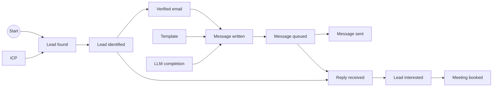

> Reference design the distribute.you production stack migrates toward: copied verbatim from GTM Factory v10 (`shamanic-technologies/gtm-factory`, `docs/framework.md`) before that repo is archived.

# GTM Factory v10: the framework

Revenue made easy. This document describes the open framework behind it: how to model a go-to-market operation as an industrial plant, with the plant's own words and its own cost accounting. Everything here is implemented in [`packages/core`](../packages/core), the scripts are code in [`scripts/`](../scripts), and every number in the worked examples is checked by a test ([`docs.test.ts`](../packages/core/test/docs.test.ts)).

**Open source and hosted.** This repository is the framework and one fictional world to adapt to your own use case. A hosted GTM Factory keeps its catalogue in its database: the outcomes, the Engines, every script and every version of its code, the Providers. It keeps every run's result there too. Its estimates sharpen over time, because what one client learns is pooled with the others. Code kept as text in a database runs through `compileScript`; the host provides isolation.

## 1. The plant

Think of a car plant. An order comes in for a car. The plant explodes the car's bill of materials: an engine, a body, four wheels; each part has its own bill of materials, down to raw steel. Each part comes from the stock when one is there, else it is ordered from the shop that makes it. The full production cost of the car is rolled up along that tree. The plant manager does not ask "which machine is cheapest?" but "which tree makes a car for the least money, and is a car worth more than that?"

Go-to-market works the same way. The raw material is a market, which always has a finite size. The finished product is a paying client. In between, shops turn outcomes into new outcomes: a market becomes found leads, a found lead becomes an identified person, a person with a verified email gets a written message, the message is queued, the mailbox reports it sent and reads the reply, a reply becomes an interested lead, an interested lead books a meeting. Some of this work is done by rules, some by AI, some by people. Some of it is ours; some is performed by the client's team, the client's CRM, the mailbox or the organic market.

The framework names this work, measures it, and picks, at every place where several candidates compete, the one with the best value per dollar. It does so with one algorithm, everywhere, and it never stops learning.



## 2. The objects

| Object | What it is |
|---|---|
| **Outcome** | A part reference: Lead interested, Message sent, Template, Rating. It says what a piece is about (its subject): a lead, a company, the brand, or the run that asked for it. |
| **Unit** | One physical piece of an outcome: Marie, interested on day 24. Every Unit lands in the ledger, names who performed it and carries its traceability. |
| **Engine** | One per outcome. It makes new Units of its outcome, and only of its outcome. Competing scripts perform it. |
| **Script** | Code that makes one Unit of its Engine's outcome, or none. Scripts of one Engine compete; each belongs to a **dynasty** of versions. |
| **Provider** | One per outcome, never in competition: the stores of that outcome. A script asks a Provider for what it needs. |
| **Run** | A production order: one script executed, one Unit or none. |
| **Request** | What a run hands to the pieces it orders whose subject is the run itself. The writer asks for the email it wants (`ctx.ask({ prompt })`), then calls `ctx.get("llm_completion")`; the LLM completion script reads that Request (`ctx.request`) and writes it. `get()` keeps no argument: the Request travels beside it. |
| **Campaign** | Orders production: a Target, a start, a budget and a strategy written as a brief. |
| **Plan** | The tree a campaign runs, recomputed at every tick: each outcome, its Engine, the script that Engine picks now, and the Plan of each outcome that script calls. It is shown as what actually ran this week: at each Engine every script that made Units is a branch, with its share and cost, the pick of this tick highlighted. Nothing about it is frozen. |
| **Connected account** | A mailbox, a WhatsApp number, a LinkedIn profile the brand connected, kept as a Unit of the brand. It names its channel and the role the brand gave it: Personal, Pro or AI agent. Several accounts may share a role on a channel. |
| **Track** | An ordered ladder of states. The CRM lifecycle track holds Lead interested, Meeting booked, Meeting attended, Paid client. The Conversation track holds Reply received. The Website visits track holds Lead visited. A state of a track is a **milestone**. Tracks are never added together. |

**Every API call output is an outcome.** A cold email is several outcomes: the writer makes a Message written; our send call makes a Message queued; the mailbox reports a Message sent and reads each Reply received. Each can be measured, priced and consumed.

**A channel is a tactic.** Cold email and LinkedIn are two scripts of the Reply received Engine; each carries the value of the tactic "Channel". A client who wants only some channels says so in the brief.

**Who performs a script is a tactic.** "Performed by" says Ours, Client's team, Mailbox, CRM or Organic market. Budget and return read only "Performed by = Ours". A script of the client's team costs us nothing; its limit is its capacity (section 6).

**Where an LLM completion is written is a tactic.** "Runs on" says Our API, Client's Claude or Client's Claude, else our API. Each value is carried by its own scripts of the LLM completion Engine. Client's Claude is the client's own Claude subscription, through the GTM Factory app on the client's Mac: it costs us $0, and while the Mac is closed the run waits. The third script asks the client's Claude first and, after 10 minutes with no app online, calls our API: the fallback lives in that script's code. A client who wants only their Claude, or their Claude first, says so in the brief, and the judge keeps the strategy "Runs on is Client's Claude" or "Client's Claude first" on that Engine, from the next tick.

**A script asks for a role, never for an account.** A sending script carries the tactic "Account role" (AI agent, Pro, Personal). It receives every connected account of the brand with that role on its channel, with each one's counts (sent today, sent and read this week), and its own code picks one: the cold email queue takes the mailbox that sent the least today; a follow-up leaves from the mailbox the first message left from (same thread, same address). The host only holds the accounts, their roles and their counts. Another way to spread the load is a new version of that script, rated like any other. A reading script runs per role with no filter, so every account is read. A campaign that wants every message from its AI agent says so in its brief, and the judge keeps the strategy "Account role is AI agent" on its sending Engines. In the fictional world, a new client gets one welcome from the Pro number, and anyone who writes to the Pro number becomes a task for the client's team, never an answer from the agent.

**The ICP is an outcome like any other.** An ICP is a plain sentence, written by the client or by an AI. Several ICPs compete as Units of the brand. A judge reads who fits a sentence: an AI in production, the hidden truth in the simulator.

**The market is Start.** A market has a finite size. A script that sources leads draws people its source covers; when its reserve empties, its yield falls and budget moves elsewhere by itself.

## 3. The six decisions

1. **One Engine per outcome.** An Engine makes one outcome; competing scripts in dynasties perform it. A script makes one outcome and may consume any outcomes. The only pick left is the script, inside the Engine of an outcome: the best value per dollar among the scripts the strategy keeps.
2. **No written manifest.** A script is code: it calls its Providers at run time. The outcomes it needs (its **materials**, for the Plan, costs and return) are read from its code: each `ctx.get("...")` names one, always a literal, and a test enforces it. Then the ledger measures what each run consumed, and an unexpected call joins the list. No judge is needed.
3. **Provider and Engine.** A Provider offers one function, `get()`, with no argument: it returns the most recent Unit of its outcome this caller has not received yet, for the caller's context (the run's subject, its company, its brand, or the run itself), from the stock, else by ordering one from the Engine. "Already received" is the ledger's record of consumption. One exception: when the brand holds several competing versions of an input (ICPs, templates), the Provider puts them against each other and the Rating picks one per run. That is how a new version proves itself against the old ones. An Engine offers `pull()` and `push(unit)`, and always makes a new piece. `pull()` makes one piece for a context, down from the Target. `push(unit)` makes the next outcome from a Unit that landed, up toward the Target.
4. **Freshness is the script's job.** A script unhappy with what it got calls `get()` again, and a new piece is made, as long as the run's budget lasts.
5. **The names.** Engine, Provider, Plan, Track.
6. **"Performed by" is a tactic of scripts.** Who runs a script is data on the script, never an object of its own.

## 4. Scripts are code

A script lives in `scripts/<outcome>/<dynasty>/v<n>.ts`. Its default export `run(ctx)` receives its subject, `ctx.get(outcome)` on the Providers, `ctx.ask(request)` and the Request it was handed (`ctx.request`), its Engine's storage, the vendor client and its tactics, and returns one Unit content or none. The email lookup, in full:

```ts
export default function run(ctx: ScriptContext): ScriptResult {
  const lead = ctx.get("lead_identified");
  ctx.get("rating");
  const failed = ctx.storage.get("failed", lead.subject);
  if (typeof failed === "number" && ctx.day - failed < Number(ctx.tactics.retry_days ?? 30)) return null;
  const r = ctx.vendor.call("apollo.reveal", { lead: lead.subject });
  if (!r.ok) {
    ctx.storage.set("failed", lead.subject, ctx.day);
    return null;
  }
  return { content: { email: r.data.email ?? null, verified: true } };
}
```

A change is a new version of its dynasty; a different idea is a fork. The simulator runs this same code against a vendor that answers from the hidden truth; a running GTM Factory runs it with real vendors.

Two scripts of one Engine may call different Providers. The short writer calls no company research; the research writer does. Both compete in the Message written Engine, and no company research is ordered for a lead only the short writer served.

A script that wants a fresh piece asks again: `if (context.ageDays > 90) context = ctx.get("brand_context")`. A script that never stops asking stops where the run's budget ends.

**Storage.** An Engine's storage holds only its scripts' notes ("no email found for this lead", "picked this person on day 12") and references to ledger Units, never copies. It is shared by the scripts of that Engine and read by nobody else. Business rules such as "Days before recontact" or "Days before retry" are tactics the script reads and enforces in its own code.

**Replay: porting existing code without losing anything.** Code moved into a script from another system is proven against what that system really did. A recorded case holds the Units the work started from, every vendor call it made in order (the answer, and the request when it was recorded) and what it produced. `replayCase(code, case)` runs the script on those Units with a vendor that answers from the record, then checks the same calls, in the same order, with the same requests, and the same result. A ported script is done only when every one of its cases matches. Cases from a real system hold real personal data: a hosted GTM Factory keeps them in its database, never in this repository.

**An answer that takes minutes.** A run lasts a moment, but some vendors answer later: the client's Claude answers in seconds to minutes, or not while the Mac sleeps. Such a vendor answers "later"; the run stops, like a run missing a milestone, and is tried again at a later tick under the same picks, so the same Request is asked again and finds its answer.

**One run, one script.** When a run does not produce its outcome, no other script is tried on that subject. A script may embed a fallback of its own, and it is then simply a different script.

## 5. Pull, push and the Plan

### The Campaign fixes a Target, never a line

A Campaign fixes only its **Target**, its start, its budget (a daily budget, with an optional volume per period) and its strategy. It never fixes a line. Its **Plan** is recomputed at every tick: from the Target down, each outcome's Engine and the script it would run now (the best mean value per dollar of the Rating, among the scripts the brief keeps), then the Plan of each outcome that script calls, down to Start or to a Unit a Provider serves. Plan, expected cost and return change at every tick.

- **Pull** (proactive, from Start): the campaign pulls on its Target. Open work nearest the Target moves first, then Units waiting in the stock at a milestone below the Target, and only then new subjects from the market, with the budget left and within its volume.
- **Push** (reactive, from any other outcome): each Unit of the start outcome that lands for the brand is pushed to the next Engine the Plan names, up toward the Target.

A Unit advances one Engine per tick. All campaigns run at each tick, each on its own budget spread over the day's ticks. An order that could not start (a script out of capacity, a cap reached) is undone, and the next tick asks again.

### Worked example: a pull

Northwind Analytics, the fictional client, runs an ads campaign. Its brief reads: "Test ads for 30 days, at most 120 visits a day, and book meetings from the signups." It has the Target Meeting booked, starts from Start, with a daily budget of $30. A meeting is worth **$600** to Northwind.

After **14** days, its Plan reads, from the Target down:

- Meeting booked, made by the slot booking script (**3** scripts compete);
- Lead interested, made by the website signup, performed by the client's team (**1** script);
- Lead visited, made by the search ads script (**2** scripts compete);
- the ICP, served from the stock (**2** ICP dynasties compete), and today's Rating.

It passes through Lead visited, Lead interested and Meeting booked. Per milestone:

| Milestone | Attempts per Meeting booked | Cost from Start |
|---|---|---|
| Lead visited | **96.5** | **$0.39** |
| Lead interested | **60.8** | **$8.51** |
| Meeting booked | **2.8** | **$24.16** |

One meeting costs **$24.16** from Start, so the expected return is $600 / $24.16 = **24.8** dollars per dollar. The signups cost nothing to us: the client's team performs them, and their cost of this outcome is $0.

### Worked example: a push

Northwind's follow-up campaign starts from Message sent and has the Target Lead interested; its brief reads: "Follow up once on every cold email that got no answer, four days later." It is reactive. The outbound campaign writes and sends; this one receives every Message sent. The next Engine its Plan names is Follow-up queued. Follow Lea, the first lead it won.

- Day **2**: Lea's Message sent lands. The campaign pushes it to the Follow-up queued Engine. The new angle script reads its tactic "Days since last message" and waits.
- Day **6**: the follow-up is queued.
- Day **8**: the mailbox reads Lea's reply and the reply judge marks her interested.
- The follow-up campaign spent **$0.10** on Lea.

The judge kept the strategy "Only people who have not answered nor asked to stop" for the Follow-up queued Engine: someone who already replied to the first email gets no follow-up.

## 6. The brief, capacity and caps

**The brief.** A campaign's strategy is a brief in plain words. A judge (an AI in production, the hidden truth in the simulator) reads it once per Engine, and again when the catalogue changes. For each Engine it keeps one of that Engine's strategies, or none: the Plan then routes around that Engine. Daily caps in the brief become most Units per day at an Engine. A test length becomes an end date. The verdicts are stored on the campaign.

A **strategy** is a set of conditions on tactics: equals, in a list, within a range. It filters the scripts of its Engine ("Channel is Cold email") and may also state who the Engine serves ("never write to people who asked to stop"). The subject is checked at every run, since a person may ask to stop while an order is open. Each Engine has a default strategy with no condition.

**Capacity.** Only work a person does has a capacity: most Units per day, and days one takes. A person types it on the "Done by your team" page. Code and AI scripts have none: an email queue that releases messages little by little is a delay, not a capacity. A script out of capacity today leaves today's picks and the order waits for tomorrow; the Plan ignores today's limits, so it still names the script.

**Tasks.** A script a person performs declares a short answer form. Each run of it is a task: in production the person is notified by email and answers on the "Done by your team" page. The answer becomes the Unit's content. Its first yes or no field says whether the outcome happened, and the Unit then credits the picks that brought the person. In the simulator the hidden truth answers: a no at once, a yes when its delay ends, unless the visitor answers first. Work done once, like the offer or the ICP the client states, shows as done.

## 7. The ledger is the common stock

Every Unit, from whoever performed it, lands in one stock. Several scripts feed one outcome: an interested lead found by our reply judge and one who signed up on the website sit side by side, and the booking script serves itself from both. A campaign never takes, for a subject it holds, the work in progress of another campaign.

**Reuse.** A Unit never wears out: information is copied, not consumed, like a mould rather than raw material. Several campaigns may consume the same Unit; the books show it as a reuse gain (section 10).

### Dynasties

Anything a pick can pick (a script, or a Unit of the brand) belongs to a dynasty of versions. The pick picks a dynasty and serves its head version. Stats pool across the versions of a dynasty. An **upgrade** is a new version of the same dynasty: it starts from the dynasty's belief. A **fork** is a new dynasty: it starts from its parent's belief. LLM models, templates and ICPs are examples of this one rule; the code holds no line about any of them.

## 8. The pick and the Supplier rating

A **candidate place** is a pair (consuming Engine, outcome it calls): the same LLM Engine called by the writer and by the reply judge makes two candidate places, and each can settle on a different model.

The **Supplier rating** is an Engine like any other. At each tick it reads the ledger and produces a **Rating** Unit for each brand: per candidate at each candidate place, its beliefs about value per dollar. Every picking script calls the Rating's Provider.

The rule is one for every pick: **Thompson sampling on value per dollar**.

1. Each candidate carries a belief about the share of its decisions that reach the next milestone, and a belief about its measured cost from the decision to that milestone.
2. Draw one rate and one cost from each belief.
3. Score each candidate: rate x value / cost.
4. Pick the highest.

A candidate with little data has wide beliefs: sometimes it draws high and gets tried. Exploration comes by construction.

### Credit through traceability

Every Unit carries its **traceability**: the picks that led to it, its own included, and those carried by the Units it consumed. When the next milestone lands, every pick on its traceability is credited. A template is scored on the replies of the messages it served, never on whether the writer wrote. Reply received is a milestone of the Conversation track, so the picks of a cold email are credited at the reply, days before an interested lead.

### A branch is rated with its own picks at their best

A candidate's measured rate mixes every pick still being learned under it. A cold email branch tried while its email finder, writer and template are still explored looks worse than it is. So the Rating multiplies a candidate's value by its **uplift**: over each candidate place under it, the best candidate's value per dollar over the value per dollar of the mix picked there this last week. The Plan reads the tree the same way.

### Pooling, delays, time

A belief is pooled across levels (the candidate everywhere it is offered, this candidate place across clients, clients sharing tactics, the client), each pulled toward the one above with a strength fitted from the data. Local data wins as it grows.

Worked example, with a fleet rate of 2% counted as 200 trials of prior experience, for a client whose true rate is 3%:

| Client data | Estimate |
|---|---|
| No trials | 2.0% |
| 3 successes out of 50 | (3 + 4) / 250 = **2.8%** |
| 30 out of 1,000 | (30 + 4) / 1,200 = **2.83%** |
| 300 out of 10,000 | (300 + 4) / 10,200 = **2.98%** |

A reply can land days after the message. A decision whose order is still open counts for the share of outcomes already due at its age; a decision whose order ended without the milestone counts in full. Worked example: 100 decisions made 7 days ago, 70% of outcomes usually arrive within 7 days, 2 successes so far, all still open. They are worth 100 x 0.7 = 70 full trials, and the estimate is 2 / 70 = **2.86%**, not 2%.

Each day's decisions are read like for like, against the other candidates' results that day, so a candidate tried while the rest was still learning is not blamed for it, and a candidate cannot excuse its own failures. Old evidence fades with a half-life, so a world that changes is read again: a source that runs dry loses its picks.

### Regret

The simulator knows the hidden truth, so it can grade the Rating. **Regret** is, per day, the share of each dollar's value the picks lost against always picking the hidden best (1 minus its value per dollar over the best's), weighted by picks, over every candidate place of every campaign, each day graded against that day's truth. On five seeds of the fictional world, regret falls between days 0 to 10 and days 50 to 60 on each seed, and its mean over days 50 to 60 stays under **0.05**.

## 9. Splits and proposals

The split mechanism looks for a tactic that separates successes from failures: a yes or no tactic splits true against false, a list tactic groups its values by rate, a number tactic is cut at the deciles of its values. A split is a conclusion only when the exact test on raw counts passes, corrected for the number of splits tried, and the like for like test inside the same client and month passes in the same direction.

A split on **leads** proposes a finer ICP: an AI script writes a new Unit, a fork of the ICP it refines, that starts from its parent's belief and competes. A split on **scripts** proposes a strategy.

## 10. The two calculations

Every decision rests on two numbers that flow in opposite directions, milestone by milestone of the campaign's Plan.

**Cost flows forward from Start.** One Unit of a milestone costs what it took to make the previous one, plus its own cost per attempt, divided by its yield:

`C(start) = 0` and `C(to) = (C(from) + c) / y`

**Value flows backward from the Target.** A paid client is worth the offer's lifetime revenue. A milestone before it is worth what you can make of it, net of what that costs, or nothing:

`V(target) = value` and `V(s) = max(0, y x V(next) - c)`

The cost of one Target Unit is `T = c1 / (y1 y2 ... yn) + c2 / (y2 ... yn) + ... + cn / yn`, and its value per dollar is `value / T`.

### Worked example

A client sells a service with a lifetime revenue of **$2,100**, through three milestones:

| From, to | Cost per attempt | Yield |
|---|---|---|
| Start to Lead interested | $1 | 2% |
| Lead interested to Meeting booked | $2 | 40% |
| Meeting booked to Paid client | $10 | 20% |

Cost forward, which a campaign page shows as each milestone's **cost from Start**: one interested lead costs $1 / 0.02 = **$50**. One meeting costs ($50 + $2) / 0.4 = **$130**. One paid client costs ($130 + $10) / 0.2 = **$700**. The **cost of this outcome** alone leaves out the milestones before it: $2 / 0.4 = $5 per meeting.

Read per paid client, the **attempts per Paid client** are 5 on meetings, 12.5 on interested leads and 625 from the market. Value per dollar: $2,100 / $700 = **3.0**.

Value backward: a meeting is worth 0.2 x $2,100 - $10 = **$410**. An interested lead is worth 0.4 x $410 - $2 = **$162**. One attempt is worth 0.02 x $162 - $1 = **$2.24** net.

### Budget and the price of a dollar

A budget is funded in order of value per dollar until it runs out. With $500 to spend, an action returning $6 per dollar that can absorb $300, and one returning $3 that can absorb $1,000: the first gets $300, the second $200. One more dollar of budget is worth **$3**: the price of the marginal dollar.

## 11. Others who perform, and reliability

Every Unit names who performed it. Everything is counted; our return values only what our runs brought in. A report from another party about a fact one of our runs made (the CRM import of an interested lead our reply judge missed) is that run's campaign's value, and credits no pick: a judge that missed a fact missed it.

Whoever attests an outcome is a script: a reply judge, a CRM import, a website tracker. **Reliability** is its agreement with the outcome's reference script on the same subjects.

## 12. Decide versus report

**To decide**, the Rating reads each candidate's own measured cost and rate, from the decision to the next milestone. **To report**, the ledger prices every outcome by every path: its own production, plus its materials at their own unit cost. Expected and measured returns share one formula and one basis: subjects the campaign made from its start, never ones it took from the stock.

A Unit keeps the price paid to produce it, its **standard cost**, and every consumption pays that price. When a Unit is consumed again, the books show a **reuse gain**. Everything reconciles to the cent:

`standard cost charged - reuse gain + spend of runs producing none = total run spend`

Worked example, in cents. A sourcing run spends 1,000 and finds 3 leads (334, 333 and 333 each). An email run spends 600, consumes the 3 leads and produces 1 interested lead. A second email run spends 300, consumes the first lead again and produces nothing. A setup run spends 500 (support). A run on a lead already interested spends 200 (abnormal loss). Total spend: 2,600.

Standard cost charged: 334 x 2 + 333 + 333 + 600 = **$19.34**. Reuse gain: **$3.34**. Runs producing none: 300 + 500 + 200 = **$10.00**. And $19.34 - $3.34 + $10.00 = **$26.00**, the total spend.

The email Engine's own cost for decisions: $9 over 4 Units consumed is **$2.25** per Unit. The unit cost of the interested lead for reports: $9 of its own production plus 4 leads at $3.33 each, about **$22.33**.

## 13. The simulator

The framework ships with one fictional world as data ([`seed/fictional-world.json`](../seed/fictional-world.json)): Northwind Analytics, a client starting from scratch tonight, with cold email, LinkedIn and ads, vendor list prices and rates from public benchmarks; its market of fictional people and companies; the catalogue; and the hidden truth (yields, costs, delays, the effect of every script, template and lead tactic). The world ticks 24 times a day. At each tick every campaign recomputes its Plan, pulls or pushes, runs land their Units after their delay, the ledger fills and the Supplier rating learns. One seed gives one history, byte for byte.

The dashboard runs it: [`apps/dashboard`](../apps/dashboard), live at https://distribute-you.github.io/gtm-factory/. Built with its api data source, the same dashboard reads a running GTM Factory through its API ([`docs/api.md`](api.md)).
